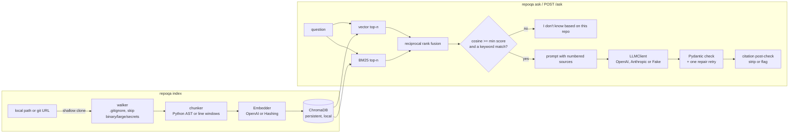

# repoqa

Ask questions about any codebase; answers cite the exact file and lines.
A retrieval-augmented generation (RAG) CLI and API with AST-aware chunking, hybrid search and verified citations.

```text
$ make demo        # offline: hashing embedder + FakeLLM, indexing this repository
╭────────────────── How are Python files split into chunks? ───────────────────╮
│ The most relevant code for this question:                                    │
│                                                                              │
│  • src/repoqa/chunking.py: Split files into citable chunks.                  │
│    [src/repoqa/chunking.py:1-53]                                             │
│  • chunk_file: def chunk_file(path: str, text: str) -> list[Chunk]:          │
│    [src/repoqa/chunking.py:77-81]                                            │
│  • chunk_python: AST-aware chunks; falls back to line windows if the file    │
│    does not parse. [src/repoqa/chunking.py:84-101]                           │
╰──────────────────────────────────────────────────────────────────────────────╯
```

## Why it's interesting

- **Citations are checked, not trusted.** After the LLM answers, every `[path:start-end]` is
  checked against the chunks that were actually retrieved. Citations to code the model never
  saw are stripped (or flagged) and reported; an answer left with no verified citation is
  replaced by "I don't know".
- **It knows when to say "I don't know".** Unless retrieval finds real evidence (a close vector
  match *and* a shared keyword), it answers `I don't know based on this repo.` without calling
  the LLM at all.
- **Code-aware chunking.** Python is split along the AST (functions, classes, methods of large
  classes), so a citation points at a whole function with its symbol name, not an arbitrary
  window. Other files use overlapping line windows.
- **Hybrid retrieval with a measured effect.** Vector search and BM25 are merged with reciprocal
  rank fusion, and `repoqa eval` reports hit@k and MRR for each retriever on a fixture repo, so
  the claim "hybrid is better" is something you can check rather than assume.
- **Production habits in a small codebase.** Timeouts, retries with exponential backoff and
  jitter, a client-side rate limiter, per-client 429s on the API, Pydantic-validated LLM output
  with one repair retry, and a fully offline demo and test suite (100% line coverage).

## Architecture



| Module | Job |
|---|---|
| `config.py` | Settings from environment variables, validated up front |
| `sources.py` | Local path, or `git clone --depth 1` into a cache (refresh with fetch + reset) |
| `walker.py` | Walk files honouring nested `.gitignore`; skip symlinks, binary, large and secret files |
| `chunking.py` | Python AST chunks with symbols and line ranges; line windows with overlap otherwise |
| `indexer.py` | The index pipeline: walk, read, chunk, embed, store |
| `text.py` | Code-aware tokenizer (`parseHttpRequest` -> parse, http, request) for BM25 and hashing |
| `embeddings.py` | `Embedder` protocol, `OpenAIEmbedder` (batched), deterministic `HashingEmbedder` |
| `store.py` | ChromaDB persistent client, one collection per repo, embedder name in metadata |
| `retrieval.py` | Vector + BM25 search and reciprocal rank fusion |
| `answer.py` | Prompt, structured-output validation and repair, "I don't know" gate |
| `citations.py` | Parse `[path:start-end]` and verify it lies inside a retrieved chunk |
| `llm.py` | `LLMClient` protocol: `OpenAIChat`, `AnthropicChat`, `FakeLLM` |
| `clients.py` | SDK client construction (SDK retries off: we retry ourselves) |
| `resilience.py` | Retry with backoff and jitter, SDK error mapping, client-side rate limiter |
| `evaluation.py` | hit@k and MRR per retrieval mode |
| `server.py` / `cli.py` | FastAPI app with a per-client token bucket; Typer CLI |

## Quickstart

Requires Python 3.12, [uv](https://docs.astral.sh/uv/) and git.

```bash
make install   # uv sync
make demo      # offline: indexes this repo, asks two questions (no API key needed)
make eval      # retrieval metrics on tests/fixtures/sample_repo
```

The demo uses the `HashingEmbedder` and `FakeLLM`, which are deterministic and need no network.
`FakeLLM` writes an extractive answer from the retrieved sources, so the whole pipeline
(retrieval, prompt, JSON validation, citation check) runs for real.

With real providers:

```bash
cp .env.example .env          # set REPOQA_EMBEDDER=openai, REPOQA_LLM=anthropic (or openai), keys
uv run --env-file .env repoqa index https://github.com/pallets/click.git
uv run --env-file .env repoqa ask "How are command-line options parsed?"
uv run --env-file .env repoqa eval tests/fixtures/questions.yaml --details
make run                      # API + UI at http://127.0.0.1:8000
```

```bash
curl -s localhost:8000/ask -H 'content-type: application/json' \
  -d '{"question": "How are citations validated?", "repo": "repoqa"}'
```

Switching embedders requires re-indexing; `repoqa ask` refuses to mix them and says so.

## Retrieval evaluation

`repoqa eval questions.yaml` indexes the repo named in the file, runs every question through
BM25-only, vector-only and hybrid retrieval, and reports hit@1, hit@3, hit@k and MRR@k
(a question "hits" when a chunk with the expected path, and symbol if given, is in the top k).
Current output with the offline `hashing-512` embedder on the 14-question bookshop fixture:

```text
      Retrieval eval: 14 questions, k=5
┏━━━━━━━━━━━┳━━━━━━━┳━━━━━━━┳━━━━━━━┳━━━━━━━┓
┃ retriever ┃ hit@1 ┃ hit@3 ┃ hit@5 ┃ MRR@5 ┃
┡━━━━━━━━━━━╇━━━━━━━╇━━━━━━━╇━━━━━━━╇━━━━━━━┩
│ bm25      │  0.71 │  0.86 │  1.00 │ 0.818 │
│ vector    │  0.50 │  0.71 │  0.86 │ 0.619 │
│ hybrid    │  0.57 │  0.93 │  1.00 │ 0.752 │
└───────────┴───────┴───────┴───────┴───────┘
            embedder: hashing-512
```

How to read it: the hashing embedder is lexical (hashed words and character trigrams), so it
adds little that BM25 does not already know. Fusing it in helps recall (hit@3 0.86 -> 0.93) but
costs precision at rank 1. That is the point of measuring: hybrid is not free, and its value
depends on the vector side bringing *different* signal, which is what semantic embeddings are
for. Run the same file with `REPOQA_EMBEDDER=openai` to compare (not run here, to keep the repo
free of paid calls). `--details` prints the rank per question and mode.

## Configuration

All settings are environment variables (see `.env.example`).

| Variable | Default | Meaning |
|---|---|---|
| `REPOQA_EMBEDDER` | `hashing` | `hashing` (offline) or `openai` |
| `REPOQA_LLM` | `fake` | `fake` (offline), `openai` or `anthropic` |
| `OPENAI_API_KEY` / `ANTHROPIC_API_KEY` | unset | Provider credentials |
| `OPENAI_MODEL` | `gpt-6.1-sol` | OpenAI chat model |
| `OPENAI_EMBEDDING_MODEL` | `text-embedding-3-small` | OpenAI embedding model |
| `ANTHROPIC_MODEL` | `claude-sonnet-5-5` | Anthropic model |
| `REPOQA_TOP_K` | `6` | Chunks sent to the LLM |
| `REPOQA_MIN_SCORE` | `0.15` | Minimum best cosine similarity before the LLM is asked |
| `REPOQA_CITATION_MODE` | `strip` | `strip` or `flag` citations that are not in retrieved chunks |
| `REPOQA_HOME` | `.repoqa` | Vector DB and clone cache directory |
| `REPOQA_REPO` | unset | Default index name for `ask` and the API |
| `REPOQA_MAX_FILE_BYTES` | `200000` | Larger files are skipped |
| `REPOQA_TIMEOUT_S` | `60` | Timeout per provider call |
| `REPOQA_MAX_RETRIES` | `4` | Retries on 429, 5xx and network errors |
| `REPOQA_MAX_CONCURRENCY` | `4` | Concurrent provider calls (client-side) |
| `REPOQA_RPM` | `120` | Provider requests per minute (client-side) |
| `REPOQA_API_RPM` | `30` | HTTP API requests per minute per client IP |

## Testing

```bash
make lint   # ruff check + ruff format --check
make test   # pytest with coverage, fails under 95%
```

Tests never touch the network: LLM and embedding calls go through `FakeLLM` or the real SDK
clients wired to an in-memory mock transport, git cloning uses a local `file://` repository,
and the API is exercised with FastAPI's `TestClient`. CI runs lint, tests and the offline demo.

## Design decisions & tradeoffs

- **Rank with RRF, gate on two signals.** RRF only uses ranks, which makes fusion easy (no
  need to put BM25 scores and cosines on one scale) but means the fused score says nothing about
  absolute relevance. So the "I don't know" gate looks at raw evidence instead, before any LLM
  call: the best cosine similarity must reach `REPOQA_MIN_SCORE` *and* at least one chunk must
  share a keyword with the question. Similarity alone was not enough: dense vectors always have
  a nearest neighbour, and on this repo off-topic questions ("How do I bake sourdough bread?")
  reached 0.22 with the hashing embedder while real fixture questions start at 0.17. None of the
  off-topic questions shared a keyword with the code. Re-tune the threshold for other embedders.
- **Citations verified by containment.** A citation is valid only if its line range lies inside
  one retrieved chunk of the same file. That catches invented files and ranges past the evidence;
  it cannot catch a correct range attached to a wrong claim (that needs an LLM judge).
- **Our own retry loop instead of the SDKs'.** Both SDKs run with `max_retries=0`; one small
  function owns backoff (full jitter, honours `Retry-After`), so behaviour is identical across
  providers and unit-testable with a fake clock. Each attempt also passes through the rate limiter.
- **Structured output by prompt + Pydantic, not provider-native JSON schemas.** It keeps the
  `LLMClient` protocol to one method that every provider and the fake can implement. The cost is
  an occasional malformed reply, handled by exactly one repair turn and then a clear error.
- **Build, then swap.** Re-indexing embeds everything first, writes a side collection, and only
  then renames it over the old one. A failed or rate-limited re-index leaves the previous index
  usable, and the API server notices the new collection id and reloads its cached BM25 index.
- **Embedder identity is stored with the index.** Mixing vectors from two embedders silently
  ruins retrieval; the retriever compares names and refuses with a fix-it message.
- **Secrets are never indexed by default.** Chunks are sent to the embedding provider, so
  symlinks (which could point outside the repo), `.env*` (except `.env.example`), keys and
  credential files (`*.pem`, `*.key`, `id_rsa*`, `.netrc`, ...) are skipped even without a
  `.gitignore`. Minified files (lines over 2,000 characters) are skipped too.
- **Anthropic specifics.** No `temperature` (rejected by the current API version), `effort:
  medium` (short grounded answers do not need deep thinking), and server-side fallback
  (`fallbacks: "default"`) so a safety-classifier decline is retried on the recommended model;
  a final refusal becomes a clear `ProviderError`.

## Limitations and roadmap

- Re-indexing is a full rebuild; incremental indexing by file hash is the next step.
- BM25 is built in memory from all chunks per process: fine for tens of thousands of chunks.
- AST chunking is Python-only; tree-sitter would extend it to other languages.
- The API server's rate limiter is in-process (use Redis for several instances), and the server
  has no authentication: keep it bound to localhost.
- The eval measures retrieval only. Answer faithfulness (LLM-as-judge, citation precision) and an
  OpenAI-embedding baseline are next.

## License

MIT, see [LICENSE](LICENSE).
